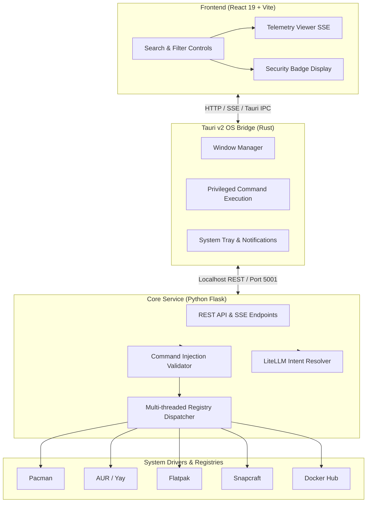

# System Architecture

Appztore is designed as a hybrid desktop application combining a low-overhead native window shell, a high-performance React UI, and a Python core service.

---

## 🧩 Core Subsystems

### 1. Frontend Layer (`desktop-app/src`)
- **React 19** with **TypeScript** for reactive state and type-safe component hierarchy.
- **Tailwind CSS** with Dark UI theme tailored for Linux power users.
- **Framer Motion** for smooth transition animations.
- **Virtual Scrolling** via `react-window` to handle thousands of search results smoothly without DOM lag.

### 2. Native Bridge Layer (`desktop-app/src-tauri`)
- Built on **Tauri v2** using **Rust**.
- Spawns the backend Python microservice on startup and terminates it cleanly on exit.
- Manages native dialogs, system tray menus, and privileged execution bridging via `pkexec`.

### 3. Backend Engine (`backend/app`)
- **Parallel Dispatch**: Searches across all package managers concurrently using a `ThreadPoolExecutor`.
- **In-Memory TTL Cache**: Fast caching of search queries to eliminate duplicate shell calls and reduce latency.
- **Strict Sanitization**: Every command is validated against malicious shell injection patterns before return.
- **Fallback Resilience**: If an external LLM fails or no API keys exist, the engine seamlessly degrades to fast native OS searches.
